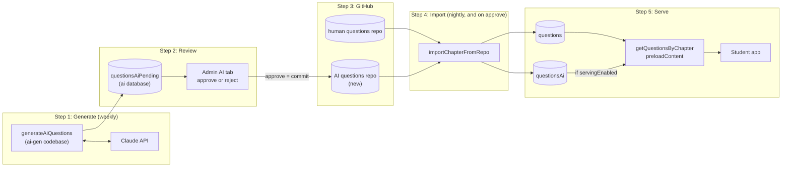
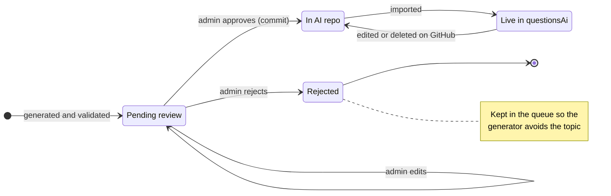
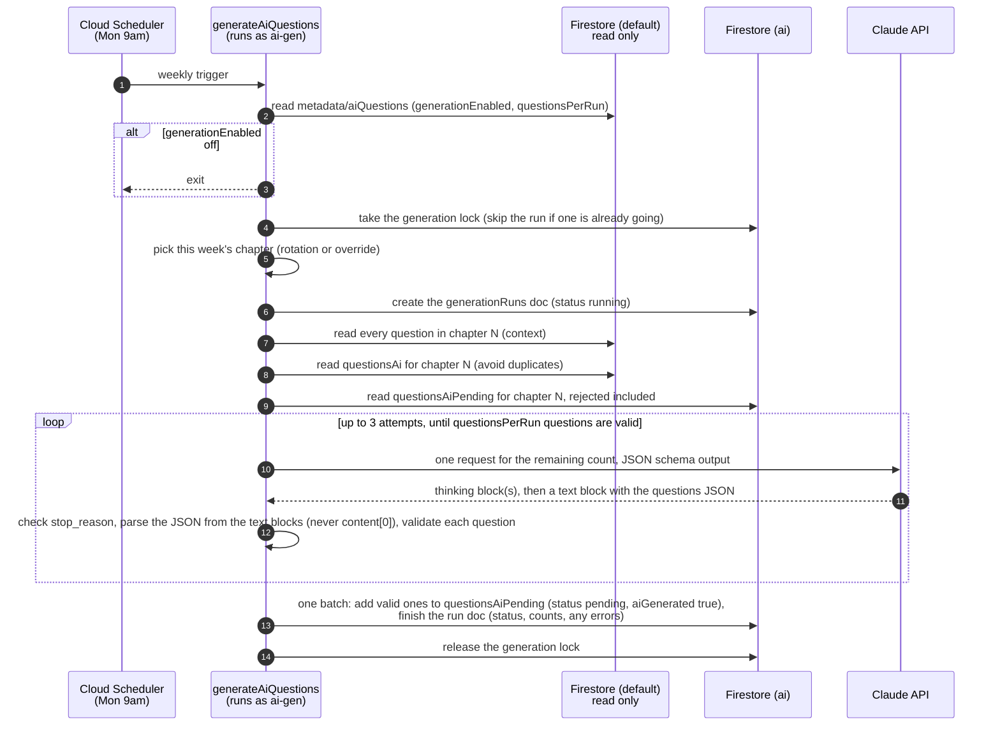

# AI question flow

> **Status:** built on branch `feature/ai-question-flow`, not deployed yet. It replaces the GitHub Actions + separate `real-estate-quest-ai` Firebase project setup; [dev.md](../dev.md) has the new setup and deploy steps.
>
> The app-side half (review, import, serving) is in `real-estate-quest` → `docs/ai-question-flow.md`. The principles, where things live, overview and lifecycle sections are the same in both repos.

## Principles

- **Repos are the source of truth for anything students see.** Firestore is a copy that can be rebuilt from the repos at any time.
- **`questionsAiPending` is a disposable review queue.** Losing it costs a regeneration, nothing more.
- **AI questions never go into `questions`.** The nightly human import deletes and reimports whole chapters, so anything else in that collection would be wiped.
- **The human questions repo stays read-only everywhere.** Only the new AI repo gets a write token.
- **The generator can only write to its own database.** It runs as its own service account, which can write the `ai` database and only read `(default)`. A bug in the generator can't change user data, subscriptions or live questions.

## Where things live

There is **one Firebase project**, the existing `real-estate-quest`. There is no separate AI project; the generator, the app, and every collection below live in it. The project has two Firestore databases: `(default)`, which exists today, and a new `ai` one.

| | What | Notes |
|---|---|---|
| Firebase project | `real-estate-quest` | The only one. Runs the app, all functions, and both Firestore databases. |
| Functions | `default` codebase from the `real-estate-quest` repo `ai-gen` codebase from the `real-estate-quest-ai-gen` repo | Two repos deploy into the same project. Deploying one never touches the other's functions. |
| Firestore `(default)` | Everything that exists today (`members`, `questions`, `flashcards`, `study_activity_logs`, ...), plus `questionsAi`, `metadata/aiQuestions` (`generationEnabled`, `servingEnabled`, `questionsPerRun`), `metadata/content` (`contentVersion`), `metadata/questionsAi` (AI file hashes), `locks/*` (per-chapter locks) | User data lives here. Point-in-time recovery plus the existing weekly backups. |
| Firestore `ai` (new) | `questionsAiPending` (review queue), `generationRuns` (one doc per run, with any error), `locks/generation` | Everything the generator writes, and nothing else. Disposable, so no point-in-time recovery or backups. |
| Service accounts | `ai-gen` (new) runs the `ai-gen` functions The app's functions keep the default one | See Access below. |
| GitHub | `real-estate-quest-questions` (existing, human) `real-estate-quest-ai-questions` (new, AI) | Both private. The source of truth for anything students see. AI files are `<chapter>.json` with the human files' fields in the same order (`chapter`, `questionNumber`, `question`, `choices`, `correctChoice`, `premium`, `explanation`), plus `aiGenerated: true` and `aiQuestionId`. |
| External | Claude API | Called only by the generator. |

### Access

Firestore can't limit server code to certain collections. Security rules work per collection, but they only apply to web and mobile clients; the Admin SDK that Cloud Functions use skips them. IAM does apply to functions, but the smallest thing it can scope to is a whole database. So everything the generator writes goes in its own database, and IAM keeps it there.

| Service account | `(default)` | `ai` |
|---|---|---|
| `ai-gen` (the generator) | read only (`roles/datastore.viewer`) | read and write (`roles/datastore.user`) |
| Default (the app's functions) | read and write | read and write |

- **Each `ai-gen` grant has an IAM condition naming its database,** such as `resource.name == "projects/real-estate-quest/databases/ai"`. A grant without a condition covers every database in the project, which is why the app's functions can already reach both.
- **`ai-gen` also gets the Anthropic key secret, and nothing else.** No GitHub tokens, no Stripe keys.
- **The generator can still read user data in `(default)`.** It can't change or delete it.
- **No keys are involved.** Both databases are in one project, so access is plain IAM.

## Overview

Everything outside Step 1 is in `(default)` except `questionsAiPending`. The generator also reads `questions` (chapter context) and `questionsAi` (to avoid duplicates) from `(default)`, read only; see the generation diagram.

## Question lifecycle

## Weekly generation (this repo)

- **One chapter per week**, with every question in that chapter sent as context. The chapter rotation repeats every 20 weeks.
- **`questionsPerRun` questions per run**, from `metadata/aiQuestions`, so it can change without a deploy. Start at 1–2 and scale to 5–10. They're generated in one request so they don't repeat each other, and the chapter context is only paid for once.
- **The generator doesn't assign `questionNumber` or `premium`.** The reviewer decides free or premium at approval, and approval assigns the number from the AI repo file, so rejected questions don't leave gaps.
- **Every run leaves a `generationRuns` doc,** including runs that produced fewer than `questionsPerRun` questions or failed. The generator can't write `function_error_logs` in `(default)`, so this is where its errors go; the admin AI tab shows the recent runs.
- **A run gets up to 30 minutes.** Both functions time out after 1800 s, the most a scheduled function can have, and the generation lock lasts 30 minutes, so it outlives any function run.

### Generate now (manual runs)

The browser can't call a scheduled function, so manual runs get their own endpoint. `generateAiQuestionsNow` is an `onCall` function in this codebase that shares the generator's core code (`runGeneration`) with the schedule. The admin page's Generate now button calls it and waits up to 30 minutes for the result.

- **Admin only.** It requires App Check and the `isAdmin` claim, like the app's other admin callables. Signed-out callers get `unauthenticated`, and anyone else without the claim gets `permission-denied`.
- **Inputs:** an optional `chapter` (1–20, defaults to this week's), `questionCount` (1–10, defaults to `questionsPerRun`), and `dryRun`, which returns the questions without adding them to the review queue (the run is still recorded). Other values get `invalid-argument`.
- **It ignores `generationEnabled`,** so you can test before turning the weekly schedule on.
- **No double runs.** It takes the same generation lock as the schedule, so a double-click or a clash with the Monday run returns "already running" (`aborted`) instead of paying for two runs.
- **Bounded cost.** A cap of 5 manual runs in the last 24 hours (dry runs count), counted from `generationRuns`, stops a stuck button or a loop from running up the Claude bill. Past it, the call returns `resource-exhausted`.
- **It records who asked:** the run record and pending docs from a manual run get `requestedBy`.

## Where the generator runs: Cloud Function

Both options are close to free. The Claude call is the real cost, and it's the same either way.

| | Cloud Function (chosen) | GitHub Actions (old code) |
|---|---|---|
| Infra cost | Free tier covers it. Cloud Scheduler gives 3 free jobs per billing account and the project already has 3, so this one is about $0.10/month | Free on a public repo; a private repo uses about 1 of 2,000 free minutes a month |
| Claude cost | On Opus 5.5, about 10 cents per run for the chapter context (up to ~25k input tokens for an 80-question chapter), plus a few cents per question. At 5–10 questions a week, a few dollars a month | Same |
| Credentials | None leave Google. Runs as its own `ai-gen` service account and reads Firestore directly, so no GitHub token either | Needs a Firebase service account key stored in GitHub, which is why a separate staging project was needed |
| Manual run | The admin page's Generate now button, which calls the admin-only `generateAiQuestionsNow` callable, or force-run the Scheduler job | Run workflow button in GitHub |

The code stays in this repo and deploys to the `real-estate-quest` project as its own functions codebase (`ai-gen`), so deploys here never touch the app's functions and vice versa.

**Why the same Firebase project, not a separate one:** the generator reads `questions` and `questionsAi` and writes `questionsAiPending`, and the app's admin functions read that same queue. In one project all of that is plain Firestore access with no credentials to manage. In a separate project, one side would need access across projects: either the generator writing into the live project, or the admin functions reading the other project. The isolation a second project would give comes from the second database instead: the generator can write only to `ai` (see Access above). The separate project only made sense when the generator ran in GitHub Actions with a key stored there.

## Changes in this repo

**Access setup (before the first deploy)**

- [ ] Create the `ai` Firestore database, in the same location as `(default)`; `scripts/setup-ai-gen-access.sh` does it. Its deny-all security rules (`firestore.ai.rules`) are listed under `firestore` in this repo's `firebase.json`, so deploys from here only touch the `ai` database's rules.
- [ ] Create the `ai-gen` service account. Grant it `roles/datastore.user` on `ai` and `roles/datastore.viewer` on `(default)`, each with an IAM condition naming the database, plus `roles/secretmanager.secretAccessor` on the Anthropic key secret only. Let whoever deploys act as it (`roles/iam.serviceAccountUser`). Running `scripts/setup-ai-gen-access.sh` does all of this and is safe to repeat; set the `ANTHROPIC_API_KEY` secret first, and `DEPLOYER_MEMBER` for the deployer grant.
- [ ] Once deployed, check the boundary with `scripts/check-ai-gen-access.sh` (it needs `roles/iam.serviceAccountTokenCreator` on `ai-gen`): a test write to `(default)` as `ai-gen` should fail with `PERMISSION_DENIED`. Then force a run of the `generateAiQuestions` job in Cloud Scheduler to check it can still invoke the function.

**Code**

- [x] Turn `src/index.js` into a `generateAiQuestions` scheduled function. Add `firebase.json` with codebase `ai-gen`, targeting the `real-estate-quest` project (`.firebaserc`). Its predeploy runs `npm test` and refuses to deploy while a `.env` file exists.
- [x] Set `serviceAccount` to `ai-gen` on both functions. Without it they run as the default account, which can write everywhere.
- [x] Use two Firestore clients ([src/firestore.js](../src/firestore.js)): `defaultDb` for reads, `aiDb` (`getFirestore(app, "ai")`) for every write.
- [x] Record each run in `generationRuns` instead of writing `function_error_logs`.
- [x] Add `generateAiQuestionsNow`, an admin-only callable (App Check + `isAdmin`) that shares the generator's core ([src/runGeneration.js](../src/runGeneration.js)). It takes `chapter`, `questionCount` and `dryRun`, and uses the shared generation lock and a daily cap.
- [x] Read few-shot examples from the Firestore `questions` collection instead of GitHub. That drops Octokit and the `GITHUB_PAT` / `QUESTIONS_REPO_PAT` mismatch.
- [x] Read duplicate-avoidance context from `questionsAi` plus every `questionsAiPending` doc for the chapter, including rejected ones.
- [x] Remove `questionNumber` assignment and the composite-index query that came with it. Stop forcing `premium: true`; the reviewer sets it.
- [x] Generate `questionsPerRun` questions in one request: the schema returns a `questions` array, and each question is validated on its own.
- [x] Bump `@anthropic-ai/sdk` from 0.39.0 to ^1.3.0 and move to `claude-opus-5-5`. Opus 5.5 always thinks, so the response starts with thinking blocks, and the old `message.content[0].text` would throw. Parse the JSON from the `text` blocks instead, which also works when a `fallback` block sits between them.
- [x] Use structured outputs (`output_config.format`).
  - **Check `stop_reason` before parsing.** The server-side fallback is on (`fallbacks: "default"`), and a `refusal` or `max_tokens` that still comes back counts the attempt as failed.
  - **`max_tokens` is 64000,** for thinking plus up to 10 questions, so the request is always streamed.
  - **`output_config.effort` is set to `high`.** Opus 5.5 defaults to `medium`.
  - **Up to 3 attempts** for any missing questions.
- [x] Read `generationEnabled` and `questionsPerRun` from `metadata/aiQuestions` before running.
- [x] Keep a local runner alongside the callable's `dryRun` option: `npm run generate:local` reads `local-generation.env` (never `.env`, which the Firebase CLI would deploy) and takes `DRY_RUN=true`.
- [x] Delete the two GitHub workflows and the staging-project setup; rewrite README.md and dev.md.

## Decisions

- **Volume:** one chapter per week with all of its questions as context. 1–2 questions per run to start, likely 5–10 later.
- **Free vs premium:** the reviewer decides at approval, premium by default, the same kind of split as the human questions.
- **Rejected questions:** kept, so the generator keeps avoiding those topics.
- **Notifications:** none. New questions just appear in the review queue on the admin page.
- **Who sees AI questions** (app side): everyone, always labeled as AI. Pro users choose Mixed (default), Human only, or AI only; free users get them mixed in.
- **Generator access:** its own `ai` database and service account inside this project, not a separate project. It can write only to `ai` and only read `(default)`.
- **Backups:** point-in-time recovery on `(default)` alongside the weekly backups. The `ai` database needs neither.

## Deviations from the plan

- **Names:** `generate`, `serve`, `perRun` and `count` are `generationEnabled`, `servingEnabled`, `questionsPerRun` and `questionCount`.
- **The local runner reads `local-generation.env`, not `.env`,** because the Firebase CLI deploys a `.env` in the functions folder as plain environment variables.
- **Dry runs are recorded:** they add nothing to the review queue, but they leave a `generationRuns` doc and count toward the daily cap.
