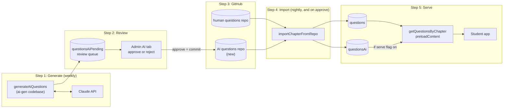
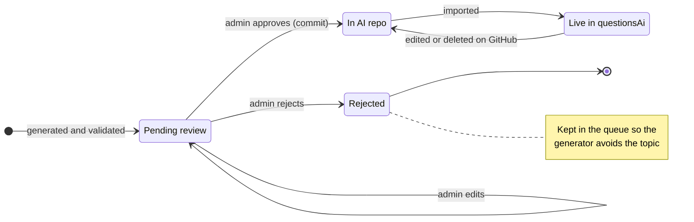
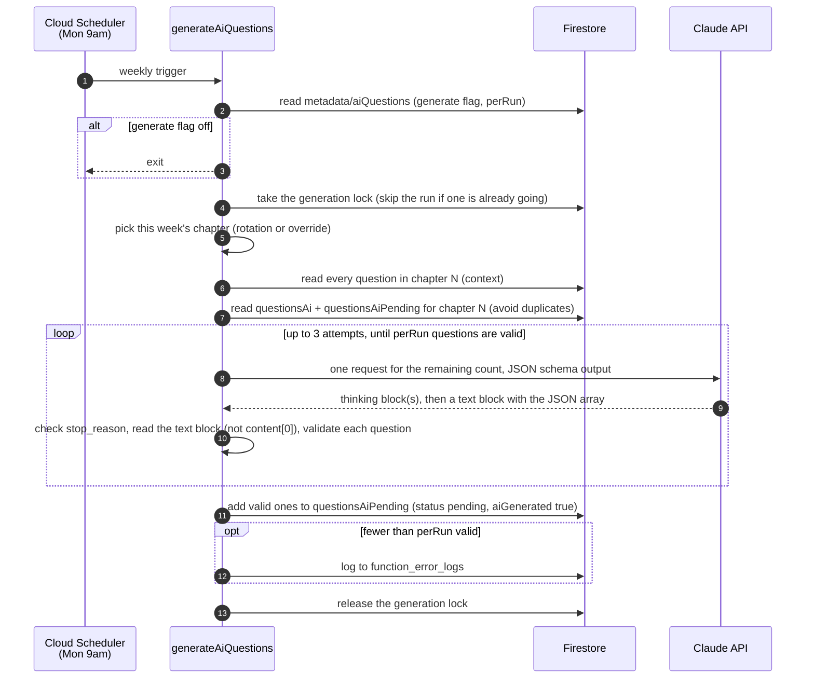

# AI question flow (proposed)

> **Status:** draft design, not built. Once built, this replaces the GitHub Actions + separate `real-estate-quest-ai` Firebase project setup described in [README.md](../README.md) and [dev.md](../dev.md).
>
> The app-side half (review, import, serving) is in `real-estate-quest` → `docs/ai-question-flow.md` on the `docs/ai-question-flow` branch. The overview and lifecycle diagrams are the same in both repos.

## Principles

- **Repos are the source of truth for anything students see.** Firestore is a copy that can be rebuilt from the repos at any time.
- **`questionsAiPending` is a disposable review queue.** Losing it costs a regeneration, nothing more.
- **AI questions never go into `questions`.** The nightly human import deletes and reimports whole chapters, so anything else in that collection would be wiped.
- **The human questions repo stays read-only everywhere.** Only the new AI repo gets a write token.

## Where things live

There is **one Firebase project**, the existing `real-estate-quest`. There is no separate AI project; the generator, the app, and every collection below live in it.

| | What | Notes |
|---|---|---|
| Firebase project | `real-estate-quest` | The only one. Runs the app, all functions, and Firestore. |
| Functions | `default` codebase from the `real-estate-quest` repo `ai-gen` codebase from the `real-estate-quest-ai-gen` repo | Two repos deploy into the same project. Deploying one never touches the other's functions. |
| Firestore | `questions` (existing), `questionsAi`, `questionsAiPending`, `metadata/aiQuestions` (switches and `perRun`), `metadata/content` (`contentVersion`), `locks/*` (per-chapter and generation locks) | All in the same database, so no credentials are needed between pieces. |
| GitHub | `real-estate-quest-questions` (existing, human) `real-estate-quest-ai-questions` (new, AI) | Both private. The source of truth for anything students see. |
| External | Claude API | Called only by the generator. |

## Overview

The generator also reads `questions` (few-shot examples) and `questionsAi` (to avoid duplicates); see the generation diagram.

## Question lifecycle

## Weekly generation (this repo)

- **One chapter per week**, with every question in that chapter sent as context. The chapter rotation repeats every 20 weeks.
- **`perRun` questions per run**, from `metadata/aiQuestions`, so it can change without a deploy. Start at 1–2 and scale to 5–10. They're generated in one request so they don't repeat each other, and the chapter context is only paid for once.
- **The generator doesn't assign `questionNumber` or `premium`.** The reviewer decides free or premium at approval, and approval assigns the number from the AI repo file, so rejected questions don't leave gaps.

### Generate now (manual runs)

The browser can't call a scheduled function, so manual runs get their own endpoint. `generateAiQuestionsNow` is an `onCall` function in this codebase that shares the generator's core code with the schedule. The admin page's Generate now button calls it.

- **Admin only.** It requires App Check and the `isAdmin` claim, like the app's other admin callables. Anyone else gets `permission-denied`.
- **Inputs:** an optional `chapter` (defaults to this week's), `count` (defaults to `perRun`, capped at 10), and `dryRun`, which returns the questions without writing them.
- **It ignores the `generate` flag,** so you can test before turning the weekly schedule on.
- **No double runs.** It takes the same generation lock as the schedule, so a double-click or a clash with the Monday run returns "already running" instead of paying for two runs.
- **Bounded cost.** A daily cap on manual runs (say 5) stops a stuck button or a loop from running up the Claude bill.
- **It records who asked:** pending docs from a manual run get `requestedBy`.

## Where the generator runs: Cloud Function

Both options are close to free. The Claude call is the real cost, and it's the same either way.

| | Cloud Function (chosen) | GitHub Actions (current code) |
|---|---|---|
| Infra cost | Free tier covers it. Cloud Scheduler gives 3 free jobs per billing account and the project already has 3, so this one is about $0.10/month | Free on a public repo; a private repo uses about 1 of 2,000 free minutes a month |
| Claude cost | On Opus 5.5, about 10 cents per run for the chapter context (up to ~25k input tokens for an 80-question chapter), plus a few cents per question. At 5–10 questions a week, a few dollars a month | Same |
| Credentials | None leave Google. Reads Firestore directly, so no GitHub token either | Needs a Firebase service account key stored in GitHub, which is why a separate staging project was needed |
| Manual run | The admin page's Generate now button, which calls the admin-only `generateAiQuestionsNow` callable, or force-run the Scheduler job | Run workflow button in GitHub |

The code stays in this repo and deploys to the `real-estate-quest` project as its own functions codebase (`ai-gen`), so deploys here never touch the app's functions and vice versa.

**Why the same Firebase project, not a separate one:** the generator reads `questions` and `questionsAi` and writes `questionsAiPending`, and the app's admin functions read that same queue. In one project all of that is plain Firestore access with no credentials to manage. In a separate project, one side would need access across projects: either the generator writing into the live project, or the admin functions reading the other project. That adds IAM setup and buys no real isolation, since the generator still needs the live question data. The separate project only made sense when the generator ran in GitHub Actions with a key stored there.

## Changes in this repo

- [ ] Turn `src/index.js` into a `generateAiQuestions` scheduled function. Add `firebase.json` with codebase `ai-gen`, targeting the `real-estate-quest` project.
- [ ] Add `generateAiQuestionsNow`, an admin-only callable (App Check + `isAdmin`) that shares the generator's core. It takes `chapter`, `count` and `dryRun`, and uses the shared generation lock and a daily cap.
- [ ] Read few-shot examples from the Firestore `questions` collection instead of GitHub. That drops Octokit and the `GITHUB_PAT` / `QUESTIONS_REPO_PAT` mismatch.
- [ ] Read duplicate-avoidance context from `questionsAi` plus every `questionsAiPending` doc for the chapter, including rejected ones.
- [ ] Remove `questionNumber` assignment and the composite-index query that came with it. Stop forcing `premium: true`; the reviewer sets it.
- [ ] Generate `perRun` questions in one request: the schema returns an array, and each question is validated on its own.
- [ ] Bump `@anthropic-ai/sdk` from 0.39.0 and move to `claude-opus-5-5`. Opus 5.5 always thinks, so the response starts with a thinking block, and today's `message.content[0].text` would throw. Read the block whose `type` is `"text"`, or use `client.messages.parse()` with the JSON schema.
- [ ] Use structured outputs (`output_config.format`).
  - **Check `stop_reason` before parsing.** On `max_tokens`, raise the limit or stream, then retry. On `refusal`, either turn on the server-side fallback (`fallbacks: "default"`) or count the attempt as failed.
  - **Size `max_tokens` for thinking plus `perRun` questions**, streaming once it's large.
  - **Set `output_config.effort` explicitly.** Opus 5.5 defaults to `medium`.
  - **Retry up to 3 times** for any missing questions.
- [ ] Read the `generate` flag and `perRun` from `metadata/aiQuestions` before running.
- [ ] Keep a local dry-run script (`DRY_RUN=true`) alongside the callable's `dryRun` option.
- [ ] Delete the two GitHub workflows and the staging-project setup; rewrite README.md and dev.md.

## Decisions

- **Volume:** one chapter per week with all of its questions as context. 1–2 questions per run to start, likely 5–10 later.
- **Free vs premium:** the reviewer decides at approval, premium by default, the same kind of split as the human questions.
- **Rejected questions:** kept, so the generator keeps avoiding those topics.
- **Notifications:** none. New questions just appear in the review queue on the admin page.
- **Who sees AI questions** (app side): everyone, always labeled as AI. Pro users choose Mixed (default), Human only, or AI only; free users get them mixed in.
